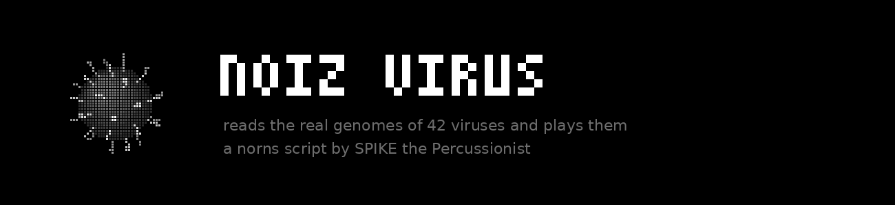
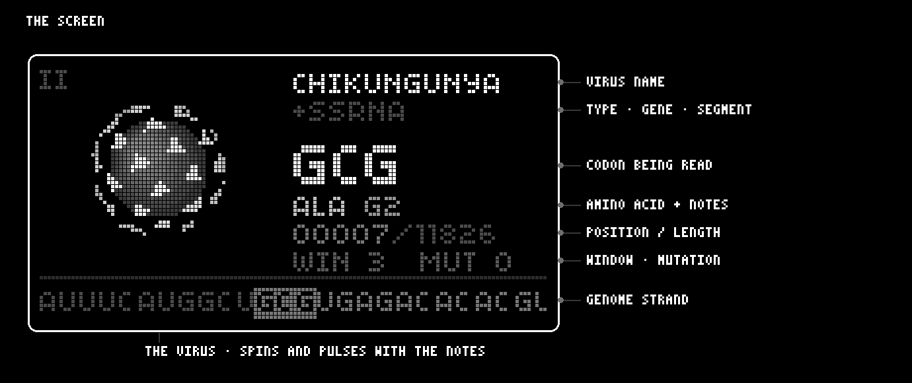
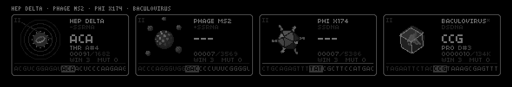
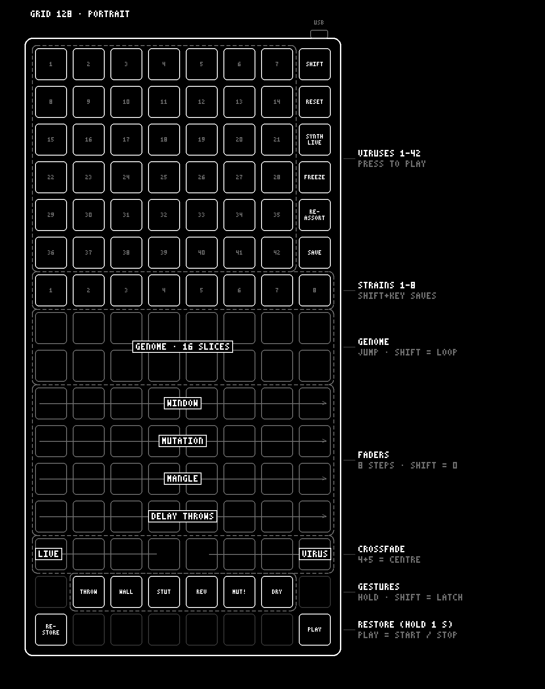
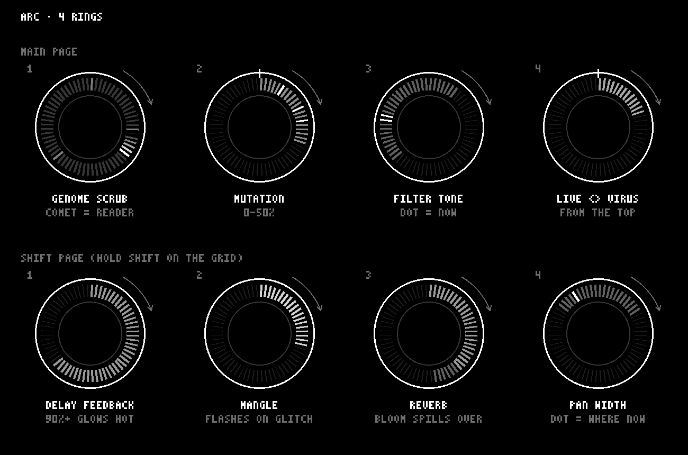
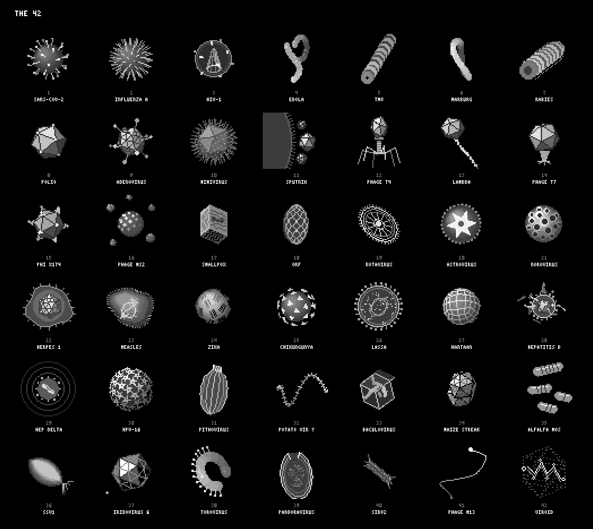

# noiz virus

v1.0 · a norns script by SPIKE the Percussionist · [manipulate.net](https://manipulate.net)

noiz virus reads the real genomes of 42 viruses and plays them. (Number 42 isn't even a virus.) Every three letters (a codon) make an amino acid, and every amino acid becomes a note in the virus's own scale. STOP codons are rests, and the start codon AUG plays accented.

Each virus has its own look, scale, sound, rhythm and effects. You can mutate them as they play, save the strains you like, and use the genome to chop up your live input with softcut. Grid and arc are supported, and it follows MIDI clock.

**Prefer paper?** The whole manual is also a PDF: [doc/noiz_virus_manual.pdf](doc/noiz_virus_manual.pdf)

---

- [requirements](#requirements)
- [install](#install)
- [quick start](#quick-start)
- [the screen](#the-screen)
- [encoders and keys](#encoders-and-keys)
- [grid](#grid)
- [arc](#arc)
- [the 42](#the-42)
- [forms](#forms)
- [mutation and strains](#mutation-and-strains)
- [the gene map](#the-gene-map)
- [rhythm from the letters](#rhythm-from-the-letters)
- [make each virus your own](#make-each-virus-your-own)
- [the sample side](#the-sample-side)
- [mix and fx](#mix-and-fx)
- [params](#params)
- [MIDI](#midi)
- [credits](#credits)

---

## requirements

- norns (or norns shield)
- optional: a varibright 128 grid (used standing up, in portrait)
- optional: an arc (4 rings)
- optional: something plugged into the norns input, for the sample side
- optional: MIDI clock and MIDI out

## install

From maiden, type:

```
;install https://github.com/SPIKE-the-Percussionist/noiz_virus
```

Or copy the whole `noiz_virus` folder into `dust/code/` on the norns. From a Mac: in Finder pick **Go > Connect to Server**, enter `smb://norns.local`, user `we`, password `sleep`, and drag the folder into `dust/code`.

Load it from **SELECT**. It opens with the NoiZ Temple logo, which derezzes into the first virus after a couple of seconds. Any key, encoder, grid press or arc turn derezzes it straight away.

## quick start

1. **K2** starts and stops the reading.
2. **E1** picks a virus. Each one sounds completely different, so try a few.
3. **E3** turns up mutation. Letters start flipping as they're read, and the changes stay in the genome.
4. **E2** changes how many letters are read at once: 1 for single letters, 3 for a codon, up to 12 for chords.
5. Plug something into the input, set **sound source** to *synth + sample* in params, and the genome chops up your live audio too. **K1 + E3** crossfades between your input and the virus.

## the screen





- **the virus** spins, pulses on every note and flinches on STOP codons.
- **name.** A **\*** after it means the virus is using a sound you saved.
- **line 2** shows the strand type (+ssRNA, dsDNA…), the gene being read, and the segment for viruses that have more than one. It also flashes messages, and shows the live <> virus bar while you crossfade. The tags on the right are the virus's form: **<<<** backwards, **DUO** two voices, **MIX** reassorted, **???** the viroid.
- **codon.** The letters being read right now, big.
- **amino acid + notes.** STOP is a rest.
- **position / length** in the genome.
- **WIN** letters per read and **MUT** mutation %.
- **the strand** at the bottom scrolls past the reader. Mutated letters are marked, and a line under the strand shows where the genes are.
- Top left: **II** when stopped, **#3** when you're playing a saved strain, **RIBO** in ribosome mode. Bottom left: **REC**, **FRZ**, **SMP** or **---** when the sample side is on.

## encoders and keys

| control | does |
|---|---|
| **E1** | virus |
| **E2** | window: letters read per step (1 = single letters, 3 = a codon, 6+ = chords) |
| **E3** | mutation %: the chance each letter flips as it's read |
| **K2** | play / stop |
| **K3** | back to the start of the genome |
| **K1 + E3** | live <> virus crossfade |
| **K1 + K2** | save this virus's sound |
| **K1 + K3** | reassort (viruses with segments) |

## grid



noiz virus uses a varibright 128 grid stood up on its end, 8 across and 16 down, with the USB at the top right. If yours comes up the wrong way round, set **grid orientation** in params to *portrait flipped*.

**SHIFT** works two ways: hold it, or tap it once to arm it for your next press (it blinks while armed).

**viruses (1-42).** Press one to play it. They glow softly, each breathing at its own pace with the odd flicker, like little organisms. Viruses with a saved sound glow a little brighter. The playing one is bright and pulses with the notes.

**the right column**

- **RESET**: back to the start of the genome. SHIFT + RESET switches ribosome mode on and off (lit when on).
- **SYNTH/LIVE**: switches the sound source between the synth (dim) and the sample side (bright). SHIFT + SYNTH/LIVE = both (mid).
- **FREEZE**: freezes or unfreezes the live loop (bright = frozen).
- **REASSORT**: shuffles the segments (segmented viruses only, brighter once shuffled). SHIFT + REASSORT jumps to a random spot in the genome.
- **SAVE**: saves this virus's sound. SHIFT + SAVE brings back its factory sound.

**strains (1-8).** Press a slot to load it. SHIFT + slot saves your mutations there. Bright = playing, mid = saved, dim = empty. More in [mutation and strains](#mutation-and-strains).

**genome (16 slices).** The two rows are the whole genome cut into 16 equal slices, and the bright one is where the reader is. Press one to jump there. To loop part of the genome, press SHIFT + a slice (it blinks), then press a second slice: the reader stays between the two. SHIFT + any slice turns the loop off, and so does jumping outside it or changing virus.

**faders.** Eight steps each, further right = more. SHIFT + any key in a fader sends it back to its start.

| fader | steps |
|---|---|
| window | 1, 2, 3, 4, 5, 6, 9, 12 letters (SHIFT = back to 3) |
| mutation | 0, 3, 6, 10, 16, 24, 36, 50% |
| mangle | 0, 5, 10, 20, 35, 50, 75, 100% |
| delay throws | 0, 5, 10, 20, 30, 50, 75, 100% |

**crossfade.** Left end = all live input, right end = all virus. Press keys 4 and 5 together (or SHIFT + any key in the row) for the centre, where both play full.

**gestures.** Hold to play, let go to stop. SHIFT + a pad latches it on; press it again to let go.

- **THROW**: everything on the tape goes into the delay.
- **WALL**: delay feedback at 100%, so nothing fades.
- **STUT**: the reader stays on the same spot, repeating it.
- **REV**: reads the genome the other way.
- **MUT!**: mutation at full (50%), then back where it was.
- **DRY**: crossfades all the way to your live input, then back.

**RESTORE** (bottom left) wipes every mutation from the genome. Hold it for a second (it fills up as you hold) so it can't happen by accident.

**PLAY** (bottom right) starts and stops.

## arc



Each ring shows its setting dim and what the genome is doing right now bright. A ring sitting at zero shows a marker at the top. Rings count from the top. Hold SHIFT on the grid (or tap it to arm it) for the second page. One full turn covers a ring's whole range (the crossfade and filter tone take about a turn each way from the middle).

**main page**

1. **genome scrub.** The ring is the whole genome. The reader is a bright comet with a tail pointing back the way it came. Segment borders are marked, mutated stretches glitter, fresh mutations spark, and a grid loop shows as a brighter arc. Turn it to scrub the reader through the genome: one turn = the whole thing.
2. **mutation** (0-50%). Fills clockwise from the top, and fresh mutations spark inside the fill.
3. **filter tone.** The dim part is your setting (left = darker, right = brighter). The bright dot is the cutoff the genome is playing right now, dancing from bottom left (low) over the top to bottom right (high).
4. **live <> virus.** From the top: turn left for more live input, right for more virus. Holding DRY on the grid makes the ring breathe.

**second page (SHIFT)**

1. **delay feedback.** Fills as it goes up. On *virus* it shows the virus's own feedback with a blinking tip. From 90% (or while WALL is held) the top of the ring glows hot: wall-of-noiz land.
2. **mangle.** The fill flashes on every glitch.
3. **reverb amount.** When gene gaps and STOPs swell the reverb, the bloom spills past the fill.
4. **pan width.** The dim span is how far the panning can go; the bright dot is where the sound is right now.

## the 42



Choosing a virus also sets its scale, register, step speed and tone. Each of the 41 norns scales belongs to exactly one virus. The VIROID gets none (see [forms](#forms)). Genomes come from NCBI RefSeq. DNA viruses are read the same way (T plays as U) but show T on screen.

| # | virus | genome | scale | root | step | character |
|---|---|---|---|---|---|---|
| 1 | SARS-CoV-2 (NC_045512.2) | 29,903 | Phrygian | A2 | 1/8 | dark, steady |
| 2 | Influenza A, PR8 H1N1 (NC_002016–23) | 8 segments, 13,588 | Dorian | D3 | 1/16 | bouncy, bright pulse |
| 3 | HIV-1 (NC_001802.1) | 9,181 | Hungarian Minor | D2 | 1/8T | low, slinky, eerie |
| 4 | Ebola, Zaire / Mayinga 1976 (NC_002549.1) | 18,959 | Locrian | C2 | 1/4 | slow, heavy, long tails |
| 5 | Tobacco mosaic virus (NC_001367.1) | 6,395 | Major Pentatonic | C4 | 1/16 | high, short plucks |
| 6 | Marburg (NC_001608) | 19,112 | Neapolitan Minor | C#2 | 1/8 | Ebola's cousin, dark |
| 7 | Rabies (NC_001542) | 11,932 | Double Harmonic | G2 | 1/16T | frantic |
| 8 | Poliovirus (NC_002058) | 7,440 | Major | C4 | 1/16 | innocent |
| 9 | Adenovirus 5 (AC_000008) | 35,938 | Six Tone Symmetrical | C3 | 1/8 | |
| 10 | Mimivirus (NC_014649) | 1,181,549 | Overtone | G1 | 1/4 | a slow giant |
| 11 | Sputnik virophage (NC_011132) | 18,343 | Lydian | C5 | 1/32 | tiny, fast, high |
| 12 | Phage T4 (NC_000866) | 168,903 | Diminished Half Whole | E2 | 1/16 | mechanical |
| 13 | Phage lambda (NC_001416) | 48,502 | Mixolydian | E3 | 1/8T | swinging |
| 14 | Phage T7 (NC_001604) | 39,937 | Major Bebop | G3 | 1/16 | punchy |
| 15 | Phage ΦX174 (NC_001422) | 5,386 | Whole Tone | E4 | 1/16T | |
| 16 | Phage MS2 (NC_001417) | 3,569 | Minor Pentatonic | A4 | 1/32 | tiny blips |
| 17 | Smallpox (variola) (NC_001611) | 185,578 | Persian | A#1 | 1/8 | ancient, heavy |
| 18 | Orf (NC_005336) | 139,962 | Eight Tone Spanish | A#2 | 1/8T | |
| 19 | Rotavirus A (NC_011500–10) | 11 segments, 18,562 | Prometheus | D3 | 1/16 | 11 sections |
| 20 | Astrovirus (NC_001943) | 6,813 | Enigmatic | D4 | 1/8 | |
| 21 | Norovirus (NC_001959) | 7,654 | Blues Scale | F2 | 1/8 | misery |
| 22 | Herpes simplex 1 (NC_001806) | 152,222 | Natural Minor | A2 | 1/4 | lingers |
| 23 | Measles (NC_001498) | 15,894 | Harmonic Minor | B2 | 1/16T | |
| 24 | Zika (NC_012532) | 10,794 | Balinese | A3 | 1/16 | bell-like |
| 25 | Chikungunya (NC_004162) | 11,826 | Mixolydian Bebop | F3 | 1/8T | |
| 26 | Lassa (NC_004296, NC_004297) | 2 segments, 10,681 | Oriental | D#2 | 1/8 | 2 sections |
| 27 | Hantaan (NC_005218, 19, 22) | 3 segments, 11,845 | Gagaku Rittsu Sen Pou | D3 | 1/4 | 3 sections, slow |
| 28 | Hepatitis B (NC_003977) | 3,182 | Melodic Minor | C3 | 1/32 | a swarm |
| 29 | Hepatitis delta (NC_001653) | 1,682 | Chromatic | C5 | 1/16T | the smallest |
| 30 | HPV-16 (NC_001526) | 7,906 | Harmonic Major | G3 | 1/16 | |
| 31 | Pithovirus (NC_023423) | 610,033 | Altered Scale | E1 | 1/4 | 30,000 years old, very low |
| 32 | Potato virus Y (NC_001616) | 9,704 | In Sen Pou | A#3 | 1/8T | floppy |
| 33 | Baculovirus, AcMNPV (NC_001623) | 133,894 | Dorian Bebop | D#3 | 1/16 | |
| 34 | Maize streak (NC_001346) | 2,689 | Neapolitan Major | F4 | 1/8 | |
| 35 | Alfalfa mosaic (NC_001495, NC_002024–25) | 3 segments, 8,274 | Okinawa | C4 | 1/8 | 3 sections |
| 36 | SSV1 (NC_001338) | 15,465 | Hungarian Major | G#2 | 1/16T | boiling |
| 37 | Iridovirus 6 (NC_003038) | 212,482 | Leading Whole Tone | G4 | 1/32T | shimmering |
| 38 | Torovirus, Breda (NC_007447) | 28,475 | Major Locrian | F#2 | 1/8 | |
| 39 | Pandoravirus (NC_022098) | 2,473,870 | Lydian Minor | F1 | 1/4 | the biggest genome of all |
| 40 | SIRV2 (NC_004086) | 35,450 | East Indian Purvi | C#3 | 1/16 | |
| 41 | Phage M13 (NC_003287) | 6,407 | Diminished Whole Half | D#4 | 1/32 | a whip |
| 42 | VIROID: potato spindle tuber viroid (NC_002030) | 359 | none | | random | makes no sense at all |

## forms

Some viruses play in a shape that comes from their real biology. Turn this off with **forms** in params.

- **Influenza A: 8 sections.** Flu's genome is 8 separate segments. Each one is a section of the piece and moves the music to a new chord. Every 8 bars (set **section length** to 4, 8 or 16 bars, or *whole segment*) it moves on to the next segment, and each segment picks up where it left off, so the piece rotates through all 8 like verses. SEG lights up on each change. **K1 + K3** (or REASSORT on the grid) shuffles the segment order, the way flu really swaps segments in nature. **MIX** shows when the order is shuffled.
- **Rotavirus (11 segments), Lassa (2), Hantaan (3), Alfalfa mosaic (3)** play in sections and reassort just like flu.
- **HIV-1: two voices (DUO).** HIV packs its genes into overlapping reading frames. A second voice reads the same letters one step over and an octave down, so the strand plays counterpoint with itself. The small codon on the right is voice 2. On MIDI it plays on its own channel (**voice 2 channel**, default 2), and **HIV voice 2 level** sets its volume.
- **Ebola and Marburg: backwards (<<<).** These are negative-strand viruses: a cell reads their template strand backwards and complemented (A↔U, G↔C), so that's how they play, from the end of the genome to the start.
- **VIROID: no sense (???).** Not even a virus: a bare loop of 359 RNA letters with no shell and no genes. It plays random pitches between the notes, in random rhythms with a random tone, still locked to the clock. NOIZ shows where the amino acid would be.

## mutation and strains

**E3** (or the mutation fader, or arc ring 2) sets the chance that each letter flips to a random one as it's read, from 0 to 50%. Mutations stay in the genome: they're marked under the strand and keep playing every time the reader comes round. At the low end a virus slowly drifts. Up around 30-50% it scrambles fast. **restore genome** in params (or holding RESTORE on the grid) puts the original letters back.

When you like what a virus has turned into, keep it as a **strain**. Each virus has 8 slots of its own.

- **save:** SHIFT + a strain key on the grid, or pick a **strain slot** in params and use **save strain**. It stores your mutations (plus the shuffled segment order for the segmented viruses). Saving an unmutated genome clears the slot.
- **load:** press a strain key, or **load strain** in params. The genome goes back to the original, your saved mutations go on top, and it reads from the start. **#3** (or whichever slot) shows at the top left while that strain plays. Loading replaces any mutations you haven't saved, so save first if you want to keep them.
- Keep mutating a loaded strain and save it again, into the same slot or a new one, to evolve it further.

Strains are kept in `dust/data/noiz_virus/strains/`. They only store the changed letters, so they're tiny, even for Pandoravirus.

## the gene map

Every genome comes with a map of its real genes from NCBI, so noiz virus knows which gene it's reading. Line 2 shows the gene's name: on SARS-CoV-2 you pass through **ORF1AB**, **S** (the spike), **E**, **M** and **N**; on HIV **GAG**, **POL**, **ENV**; on flu **HA** and **NA**. The name flashes when a new gene begins. Between genes, line 2 dims back to the strand type. Under the strand, a bright line runs under genes and a dark one between them, with a tick where each gene starts.

Where NCBI only gives a catalog number, the name comes from the protein the gene makes (TMV's coat protein shows as **COAT**). Unnamed ones show as ORF and a number. Polio, Zika, Chikungunya and Potato virus Y make one giant protein, so they read as one long gene, **POLY**. Some genes have one-letter names, like the big **L** gene in Ebola, Marburg, Measles, Rabies, Lassa and Hantaan. The VIROID has no genes at all.

In params, under **gene map**:

- **gene names**: on or off (also turns off the map under the strand).
- **each gene**: *transposes* (default) moves each gene a few steps up or down the scale, so a genome plays like a song in parts. *changes tone* gives each gene its own filter colour. *no change*.
- **between genes**: *quiet* (default) plays the gaps softer and darker, with longer gaps dipping deeper. *silent* makes them rests. *play* makes no difference.
- **ribosome reads**: with **read mode** on *ribosome*, *real genes* (default) jumps from real gene start to real gene start and plays each gene as its actual protein. Genes on the opposite strand are read backwards and complemented, so you'll see the strand scroll the other way. *any AUG* hunts for any start codon instead.

## rhythm from the letters

G and C pair with three hydrogen bonds; A and U pair with only two. With **rhythm** on *bonds* (the default), every read lasts as long as its bonds are strong:

- 0 or 1 G/C in the codon: 1 step
- 2 G/C: 2 steps
- 3 G/C: 3 steps, a held note

So every genome has its own groove, and G/C-rich stretches slow down and ring out. Set **rhythm** to *even* for a straight step sequence.

## make each virus your own

Change a virus's sound in params (scale, root, step, release, cutoff, pulse width) until you like it, then press **K1 + K2** (or SAVE on the grid, or **save sound for this virus** in params). SOUND SAVED flashes, and from then on that virus always comes back with your sound, even after a restart. A **\*** after the name means it's using your sound.

**factory sound for this virus** in params (or SHIFT + SAVE on the grid) puts the original back and the **\*** disappears.

Your sounds are kept in `dust/data/noiz_virus/sounds.txt`, so they survive updates to the script. To keep one sound for every virus instead, set **virus sets sound** to *manual*.

## the sample side

noiz virus can also chop up audio with softcut while the genome plays. Set **sound source** (params > **sample**) to *synth*, *sample* or *synth + sample*.

- **sample input.** *live input* (default): softcut keeps recording the norns input into a rolling loop of the last **live loop length** (1, 2, 4 or 8 bars, following the tempo), and the virus chops up whatever is coming in. Set **live loop** to *frozen* (or FREEZE on the grid) to stop recording and keep mangling what's there. *sample file*: choose a file in **sample file** (from `dust/audio`, up to about 5½ minutes, first channel).
- **How the genome cuts the tape.** Every read jumps to one of the **slices** (default 16) and loops it until the next read. The amino acid picks the slice, so the same codon always lands on the same spot. With **sample pitch** on *follows notes*, the slice plays at the pitch of the note, in the virus's scale. STOPs and rests cut to silence, and the bond rhythm sets how long each slice rings.
- **The forms and gene map carry over.** Ebola and Marburg play the tape backwards. The segmented viruses give each segment its own part of the tape. HIV's second voice gets its own playhead an octave down. Each gene leans on its own slices. The VIROID shreds it: random slices, speeds and directions.
- **mangle.** 0% (default) is musical. Turn it up for glitches: stutters, reverses, octave jumps and jumps to random slices. A freshly mutated letter is twice as likely to glitch.
- **glitch pick.** *virus flavor* (default): every virus rolls loaded dice, so it glitches in its own way while staying random. *even odds*: all four glitches equally likely.
  - leans to **stutter**: TMV, Rabies, Mimivirus, ΦX174, Smallpox, Orf, Norovirus, Chikungunya, Hep delta, Potato virus Y, Baculovirus, SIRV2, M13
  - leans to **reverse**: HIV-1, Ebola, Marburg, Adenovirus, Measles, Lassa, Hepatitis B, Maize streak, Torovirus
  - leans to **octave jump**: Polio, T4, T7, MS2, Astrovirus, HPV-16, Pithovirus, SSV1, Iridovirus 6
  - leans to **jump elsewhere**: SARS-CoV-2, Influenza A, Sputnik, Lambda, Rotavirus, Herpes 1, Zika, Hantaan, Alfalfa mosaic, Pandoravirus
  - the VIROID ignores the dice and shreds everything anyway.
- **sample level.** Volume of the tape.

## mix and fx

**mix**

- **live input.** How loud the dry input comes straight through. Turn it down and the live loop still records.
- **noiz virus.** How loud everything noiz virus makes is: synth and tape together.
- **live <> virus.** One-knob crossfade, also on **K1 + E3**, the grid's crossfade row and arc ring 4. The centre plays both full. While you turn it, line 2 shows a bar from **L** to **V**.
- Leaving the script puts the norns system mix back the way it was.

**fx.** Every virus has its own tape filter, reverb room, delay and panning, all on from the start (gently), and the genome plays them.

- **tape filter.** *virus* (default) uses the virus's own lowpass, highpass or bandpass. Or pick one type for every virus, or *off*. The cutoff follows the virus's synth **cutoff**.
- **filter tone.** Shifts the cutoff up or down, up to 3 octaves either way.
- **filter resonance.** Adds resonance on top of the virus's own.
- **genome moves filter** (50%). G/C-rich reads open the filter, A/U-rich reads close it. Each gene gets its own colour, a fresh mutation makes a resonant squelch, and the gaps between genes close it down.
- **reverb.** *virus room* (default), or pick *small*, *room*, *hall*, *cathedral* or *off* for every virus. This is the norns system reverb, and leaving the script puts your settings back.
- **reverb amount** (35%). How much goes into the reverb overall.
- **genome moves reverb** (50%). Gene gaps swell into the reverb, and STOPs throw a tail: a ghost of the slice carries on into the reverb.
- **reverb: synth / tape / live input.** How much of each goes in. The live input is 0% by default, so your dry signal stays dry.
- **delay throws** (20%). The delay works on the tape. On each read the dice may throw it into the delay, catching 1 to 3 reads in a row. Freshly mutated letters are twice as likely to get thrown.
- **delay time.** *virus* (default) uses the virus's own time, synced to the clock, or pick one for every virus. The VIROID picks a new time on every throw.
- **delay feedback.** *virus* (default) uses the virus's own feedback, from short slapbacks to long trails. Turn it up for 0-100% in 1% steps. At 100% nothing ever fades: every throw piles onto a wall of noiz. It keeps growing as long as throws land, so watch your levels, and pull the feedback or throws down to let it go.
- **delay level** (70%). 0% turns the delay off.
- **delay ping-pong** (on). Echoes land on the other side of the stereo field from the slice.
- **panning.** *virus* (default) gives every virus its own panning character, moving the synth and the tape (never your live input): *still*, *rarely* (now and then one read jumps out), *wander* (drifts slowly), *bounce* (somewhere new on every read), *letters* (A and G lean left, C and U lean right) or *split* (HIV's two voices sit left and right, segments each get their own place). The VIROID pans at random. Or pick one character for every virus, or *off*.
- **pan width** (70%). How far the panning goes.

## params

Besides everything above:

- **read mode.** *raw* reads every letter in order. *ribosome* does what a cell does: hunts for the next AUG, reads codons until a STOP, then hunts again, so real genes come out as phrases.
- **step.** Clock division (each virus sets its own; change it here).
- **at end of genome.** Loop, or stop.
- **midi start.** *restart* from the top, or *keep place*.
- **jump to random spot.**
- **notes.** Scale and root.
- **synth.** PolyPerc: cutoff, release, pulse width, gain, pan. **GC brightness** opens the filter on G/C-rich stretches.
- **midi out.** Output: audio, midi or both. Device, channel and gate %.
- **grid orientation.** *portrait* or *portrait flipped*.
- **visual.** Spin speed.

## MIDI

**Clock.** Go to **PARAMS > CLOCK** and set **source** to **midi**, and make sure the incoming device has clock enabled in **SYSTEM > DEVICES > MIDI**. noiz virus follows the tempo, and your gear's START and STOP start and stop the reading. By default START restarts from the top of the genome.

**Notes out.** Set **output** to *midi* or *audio + midi* in params, then pick the device and channel. HIV's second voice plays on **voice 2 channel**.

## credits

noiz virus by SPIKE the Percussionist · the NoiZ Temple · [manipulate.net](https://manipulate.net)

Genomes and gene maps: NCBI RefSeq. Made with norns by monome.
